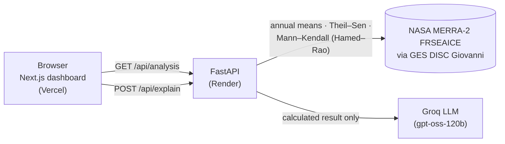

# 🌍 TerraVision AI — Environmental Analytics Dashboard

**Detecting and explaining long-term polar sea-ice trends with NASA data.**  
Built for the NASA International Space Apps Challenge.

<p align="center">
  <strong>Turning Earth observation data into meaningful environmental insights.</strong>
</p>

<p align="center">
  <a href="https://environmental-analytics-dashboard.vercel.app">Live Dashboard</a> •
  <a href="https://nasa-challenge-backend-nil7.onrender.com/docs">API Documentation</a>
</p>

[](LICENSE)


## 🎥 Demo video

Scan the QR code or use the link below to watch the project demo.

<p align="center">
  <a href="https://www.image2url.com/r2/default/videos/1794346763897-efaa2efa-9103-46f1-8997-d7f2f338cb09.mp4">
    
  </a>
  <br />
  <a href="https://www.image2url.com/r2/default/videos/1794346763897-efaa2efa-9103-46f1-8997-d7f2f338cb09.mp4">Watch the demo video</a>
</p>

## Overview

TerraVision AI makes Earth observation data easier to explore and understand. This dashboard focuses on long-term sea-ice trends in the Arctic and Antarctic, using NASA MERRA-2 data and statistical methods to present the results clearly.

Environmental data can be difficult to find, interpret, and communicate. TerraVision AI brings the data, trend analysis, visualizations, and plain-language explanations together in one accessible interface.

The current implementation focuses on polar sea ice. The application is designed so additional datasets can be added as the project grows.

## Quick start for judges

| | |
| --- | --- |
| **Live dashboard** | https://environmental-analytics-dashboard.vercel.app |
| **Live API (interactive docs)** | https://nasa-challenge-backend-nil7.onrender.com/docs |

> The API runs on Render's free tier and may sleep when idle. The first request after a pause can take about 50 seconds; the dashboard explains the wait.

### Run locally

Requirements: Node.js 20.9+ and Python 3.10+. Start the backend and frontend in separate terminals.

**1. Start the backend** at `http://127.0.0.1:8000`:

```bash
cd backend
python3 -m venv .venv && source .venv/bin/activate
pip install -r requirements.txt
uvicorn app.main:app --reload
```

**2. Start the frontend** at `http://localhost:3000`:

```bash
cd frontend
npm install
npm run dev
```

By default, the frontend forwards `/api/*` requests to `http://127.0.0.1:8000`. To use the live API instead, copy the example environment file inside `frontend/` before starting the app:

```bash
cp .env.example .env.local
```

AI explanations require a [Groq](https://groq.com) API key in `backend/.env`:

```env
GROQ_API_KEY=your-key
```

The rest of the dashboard works without an AI key.

## The problem

Environmental data is often spread across datasets and scientific tools, while interpreting long-term trends can require statistical expertise. This can make it harder for non-specialists to explore the data and understand what the results do—and do not—show.

## Our solution

The dashboard analyzes monthly NASA MERRA-2 sea-ice data for the Arctic and Antarctic. It summarizes the observations as annual means, calculates trend statistics in Python, and displays the results with an interactive chart or table.

AI-generated explanations are limited to describing the calculated statistics. The model does not perform the analysis or supply additional numbers, causes, or mechanisms.

## Features

- **NASA data:** Monthly MERRA-2 sea-ice fraction, area-averaged over the Arctic (66–90°N) and Antarctic (66–90°S), from January 1980 to January 2026.
- **Statistical analysis:** Annual means for complete calendar years, Theil–Sen slope, and the Hamed–Rao modified Mann–Kendall significance test (α = 0.05).
- **Interactive results:** Explore annual values in a chart or table, alongside trend direction, slope, p-value, and significance.
- **Guarded AI explanations:** The language model receives the calculated result and may explain the statistics, but cannot change them or add unsupported numbers, causes, or mechanisms.
- **Accessible and responsive interface:** Keyboard-navigable chart, table view, screen-reader labels, reduced-motion support, light and dark themes, and layouts from 320 px phones to 4K screens.
- **Resilient experience:** Browser-side result caching, rate-limit countdowns and automatic retries, and clear messaging while the API wakes from idle.
- **Extensible dataset configuration:** Adding a dataset is designed to require a configuration file and registry entry, with charts, cards, validation, and types adapting automatically.

## Data and methods

### Dataset

Global Modeling and Assimilation Office (GMAO) (2015), *MERRA-2 tavgM_2d_flx_Nx: 2d, Monthly mean, Time-Averaged, Single-Level, Assimilation, Surface Flux Diagnostics V5.12.4* (M2TMNXFLX), Greenbelt, MD, USA, Goddard Earth Sciences Data and Information Services Center (GES DISC), doi:[10.5067/0JRLVL8YV2Y4](https://doi.org/10.5067/0JRLVL8YV2Y4).

Variable: `FRSEAICE` (sea-ice covered fraction of tile), at 0.5° × 0.625° resolution.

### Data access

Area-averaged monthly time series were exported from [NASA Giovanni](https://giovanni.gsfc.nasa.gov/giovanni/) for these bounding boxes:

- Arctic: `(-180, 66, 180, 90)`
- Antarctic: `(-180, -90, 180, -66)`

The raw exports are in `data/`; the backend reads identical copies in `backend/app/data/`.

> Analyses and visualizations used in this project were produced with the Giovanni online data system, developed and maintained by the NASA GES DISC.

### Statistical methods

The backend calculates annual means from complete calendar years, then estimates trends using the Theil–Sen slope and tests significance using the Hamed–Rao modified Mann–Kendall method.

- Sen, P. K. (1968). Estimates of the regression coefficient based on Kendall's tau. *Journal of the American Statistical Association*, 63(324), 1379–1389.
- Hamed, K. H., & Rao, A. R. (1998). A modified Mann–Kendall trend test for autocorrelated data. *Journal of Hydrology*, 204, 182–196. doi:10.1016/S0022-1694(97)00125-X

## Architecture



| Layer | Technology |
| --- | --- |
| Frontend | Next.js 16 (App Router), React 19, TypeScript (strict), Tailwind CSS 4, TanStack Query 5, Framer Motion, Zod, Lucide |
| Backend | FastAPI, Pydantic v2, pandas, NumPy, SciPy, Uvicorn |
| AI | Groq API (`openai/gpt-oss-120b`) |
| Hosting | Vercel (frontend), Render (backend) |

Main API endpoints (full list at `/docs`):

- `GET /health`
- `GET /api/analysis?region=arctic|antarctic`
- `GET /api/series?region=…`
- `POST /api/explain`

## Repository structure

```text
.
├── backend/        FastAPI service: CSV loading, annual means, trend tests, AI explanations
├── frontend/       Next.js dashboard (see frontend/README.md)
├── data/           Original NASA Giovanni CSV exports
├── DEPLOYMENT.md   Vercel + Render deployment guide
└── LICENSE         MIT
```

## Team

Built by a team of developers and analysts participating in the NASA Space Apps Challenge 2026.

| Team Member | Role |
| --- | --- |
| Abdullah Huseynli | Full-Stack Developer |
| Mehemmed Xelilli | Data Analyst |
| Mehemmed Hasan | Frontend & Backend Developer |
| Murad Khalil | Presentation & Demo Lead |

## Testing

```bash
cd backend && pip install -r requirements-dev.txt && python -m pytest -q
cd frontend && npm run check && npm run build
```

The frontend command runs linting and type checking, followed by a production build.

## Deployment

The frontend is hosted on Vercel with `frontend` as the root directory. The backend is hosted on Render with `backend` as the root directory.

See [DEPLOYMENT.md](DEPLOYMENT.md) for deployment steps, environment variables, and troubleshooting.

## Data attribution and license

NASA data are openly available under NASA's Earth Science Data and Information Policy. This project is released under the [MIT License](LICENSE).

TerraVision AI is an entry to the NASA International Space Apps Challenge. It is not affiliated with or endorsed by NASA.

## Acknowledgments

- NASA and the GES DISC for Earth observation data and the Giovanni online data system.
- NASA Space Apps Challenge for bringing teams together to build solutions to global challenges.
- The open-source community for the tools and technologies used in this project.

---

<p align="center">
  <strong>TerraVision AI — Understanding Our Planet Through Data.</strong>
  <br/>
  Built for NASA Space Apps Challenge 2026 🚀
</p>
