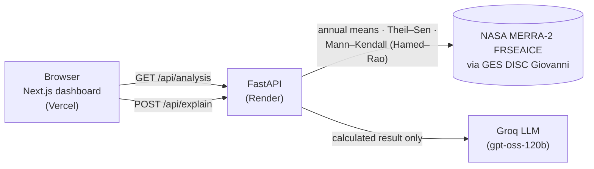

# Environmental Analytics Dashboard

**Detecting and explaining long-term polar sea-ice trends with NASA data.**
Built for the NASA International Space Apps Challenge.

[](LICENSE)


## Quick start for judges

| | |
| --- | --- |
| **Live dashboard** | xxxxxx |
| **Live API (interactive docs)** | https://nasa-challenge-backend-nil7.onrender.com/docs |

> The API runs on Render's free tier, which sleeps when idle. The first request after a
> pause can take about 50 seconds; the dashboard says so while it waits.

**Run it locally** (Node.js 20.9+, Python 3.10+), in two terminals:

```bash
# 1) Backend → http://127.0.0.1:8000
cd backend
python3 -m venv .venv && source .venv/bin/activate
pip install -r requirements.txt
uvicorn app.main:app --reload
```

```bash
# 2) Frontend → http://localhost:3000
cd frontend
npm install
npm run dev
```

The frontend forwards `/api/*` to `http://127.0.0.1:8000` by default. To skip the
backend and use the live API instead, run `cp .env.example .env.local` inside `frontend/`
before `npm run dev`. AI explanations need a [Groq](https://groq.com) key in
`backend/.env` (`GROQ_API_KEY=...`); everything else works without one.

## What it does

1. **Loads NASA data:** monthly MERRA-2 sea-ice fraction, area-averaged over the Arctic
   (66–90°N) and the Antarctic (66–90°S), January 1980 to January 2026.
2. **Computes the trend in Python:** annual means of complete calendar years, a Theil–Sen
   slope, and a Hamed–Rao modified Mann–Kendall significance test (α = 0.05).
3. **Visualises it:** an interactive annual chart (or table), the trend direction, slope,
   p-value and significance.
4. **Explains it in plain language:** a language model receives only the calculated
   result. The backend rejects any explanation that adds numbers, causes or mechanisms,
   so the AI can describe the statistics but never change them.

### Highlights

- **Scientifically honest:** every number comes from deterministic Python statistics;
  the AI layer is a guarded narrator, not an analyst.
- **Built to grow:** datasets are configuration. Adding one (e.g. temperature, CO₂,
  vegetation) is one config file plus one registry line; charts, cards, validation and
  types adapt automatically.
- **Accessible and responsive:** keyboard-navigable chart with a table view, screen-reader
  labels, reduced-motion support, light and dark themes, from 320 px phones to 4K screens.
- **Resilient:** results are cached in the browser, rate limits show a countdown and
  retry automatically, and a sleeping server is explained instead of showing a blank page.

## Architecture



| Layer | Technology |
| --- | --- |
| Frontend | Next.js 16 (App Router), React 19, TypeScript (strict), Tailwind CSS 4, TanStack Query 5, Framer Motion, Zod, Lucide |
| Backend | FastAPI, Pydantic v2, pandas, NumPy, SciPy, Uvicorn |
| AI | Groq API (`openai/gpt-oss-120b`) |
| Hosting | Vercel (frontend), Render (backend) |

```
.
├── backend/        FastAPI service: CSV loading, annual means, trend tests, AI explanations
├── frontend/       Next.js dashboard (see frontend/README.md)
├── data/           Original NASA Giovanni CSV exports
├── DEPLOYMENT.md   Vercel + Render deployment guide
└── LICENSE         MIT
```

Main API endpoints (full list at `/docs`): `GET /health`,
`GET /api/analysis?region=arctic|antarctic`, `GET /api/series?region=…`,
`POST /api/explain`.

## NASA data and attribution

**Dataset.** Global Modeling and Assimilation Office (GMAO) (2015), *MERRA-2
tavgM_2d_flx_Nx: 2d, Monthly mean, Time-Averaged, Single-Level, Assimilation, Surface Flux
Diagnostics V5.12.4* (M2TMNXFLX), Greenbelt, MD, USA, Goddard Earth Sciences Data and
Information Services Center (GES DISC), doi:[10.5067/0JRLVL8YV2Y4](https://doi.org/10.5067/0JRLVL8YV2Y4).
Variable: `FRSEAICE` (sea-ice covered fraction of tile), 0.5° × 0.625°.

**Access.** Area-averaged monthly time series were exported from
[NASA Giovanni](https://giovanni.gsfc.nasa.gov/giovanni/) for the Arctic
(-180, 66, 180, 90) and Antarctic (-180, -90, 180, -66) bounding boxes. The raw exports are
in `data/`; the backend reads identical copies in `backend/app/data/`.

> Analyses and visualizations used in this project were produced with the Giovanni online
> data system, developed and maintained by the NASA GES DISC.

**Roadmap datasets** (shown as "soon" in the dashboard, not yet integrated): NASA GISS
surface temperature analysis, NASA OCO-2 carbon dioxide, NASA MODIS vegetation index.

**Methods.**
Sen, P. K. (1968). Estimates of the regression coefficient based on Kendall's tau.
*Journal of the American Statistical Association*, 63(324), 1379–1389.
Hamed, K. H., & Rao, A. R. (1998). A modified Mann-Kendall trend test for autocorrelated
data. *Journal of Hydrology*, 204, 182–196. doi:10.1016/S0022-1694(97)00125-X

## Testing

```bash
cd backend && pip install -r requirements-dev.txt && python -m pytest -q
cd frontend && npm run check && npm run build   # lint + typecheck, then production build
```

## Deployment

Frontend on Vercel (Root Directory `frontend`), backend on Render (Root Directory
`backend`). Step-by-step instructions, environment variables and troubleshooting are in
[DEPLOYMENT.md](DEPLOYMENT.md).

## License and disclaimer

Released under the [MIT License](LICENSE). NASA data are openly available under NASA's
Earth Science Data and Information Policy. This project is an entry to the NASA
International Space Apps Challenge; it is not affiliated with or endorsed by NASA.
